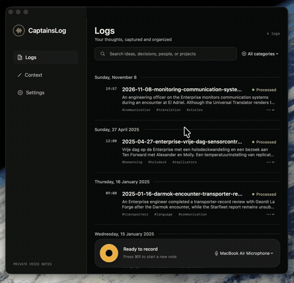

# CaptainsLog

Turn spoken thoughts into clear, searchable notes. CaptainsLog records, transcribes,
cleans up and organizes your audio on your Mac, without uploading recordings or notes.
It’s free, open source and inspired by Star Trek’s captain’s logs.

[](https://captainslog.koenvangilst.nl/#watch)

[Watch the 80-second video](https://files.koenvangilst.nl/u/GjP2Vu.mp4).

## Install

Requires **Apple Silicon and macOS 26 or later**. An M4 MacBook Air with 16 GB
of memory is the tested, recommended minimum for the default models.

```sh
brew install --cask vnglst/tap/captainslog
```

The app is ad-hoc signed and not notarized. The cask removes macOS quarantine;
install only if you trust this project.

First launch needs internet access to download several gigabytes of models.
Recording and processing run locally after setup. Smart search downloads its
model on first use.

## Use

1. Open CaptainsLog and choose where to save your notes and which categories to use.
2. Record a thought. Pause and resume as needed, then stop to process it.
3. Read the finished note with its title, summary and tags, play the original audio,
   or search by words and meaning.

Add background and spelling corrections in **Context** to help with names and terms.
You can also import M4A or QuickTime audio by placing it in your data folder’s `audio/` directory.

Notes are plain Markdown in `logs/` within your data folder. Original audio is kept. Review important
names, facts and wording before relying on generated text. **Reprocess** replaces
generated results using your current settings; it keeps the audio.

## Updates and removal

Updates install automatically when the app is idle. Manage them in **Settings → Updates**,
or quit the app and run `brew update` followed by `brew upgrade --cask captainslog`.

To uninstall, including downloaded models, while keeping your logs and configuration:

```sh
brew uninstall --cask --zap captainslog
```

Models go to the Trash; empty it to reclaim storage. Models in folders you selected
are left untouched.

## Command-line use

The installation includes `cl`, which works independently of the app:

```sh
cl pipeline                         # Record and process a memo
cl pipeline --input recording.m4a    # Process an existing file
cl search "Darmok"
cl --help
```

## Learn more

- [Build and contribute](CONTRIBUTING.md)
- [Changelog](CHANGELOG.md)
- [Technical overview](https://captainslog.koenvangilst.nl/technical.html)
- [Report a problem or suggest an improvement](https://github.com/vnglst/CaptainsLog/issues)
- [Detailed app behavior and CLI reference](agent-guides/app-behavior.md)

## License

[MIT](LICENSE). Third-party software, models and example content retain their own
licenses; see [third-party notices](THIRD-PARTY-NOTICES.md).
