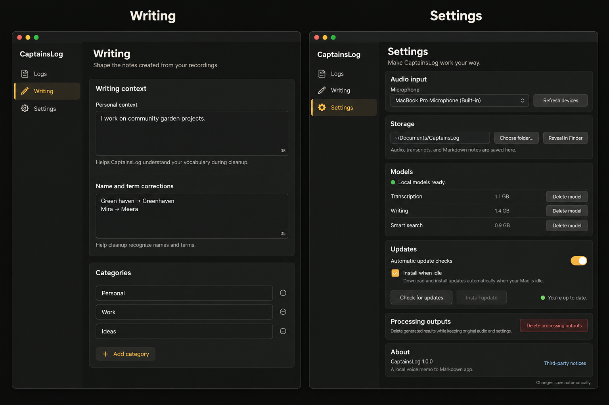

# Context and Settings redesign

The owner selected a separate **Context** navigation item containing all settings
that affect the output. Do not include a note preview. Preserve the current
designs of the individual settings, including corrections and categories.

Reorganize Settings in the order shown in alternative 1, without a submenu.
Category drag-and-drop ordering is separate work, tracked in TASK-53.

## Selected design reference

This generated concept still uses the earlier **Writing** label. The selected
label is **Context**. The image is a layout reference, not a product screenshot;
its controls, version, disk sizes, and example values are illustrative. Preserve
the existing settings editors in implementation.

